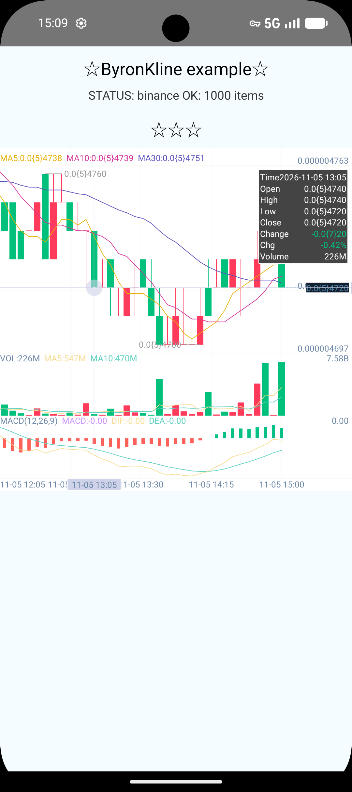
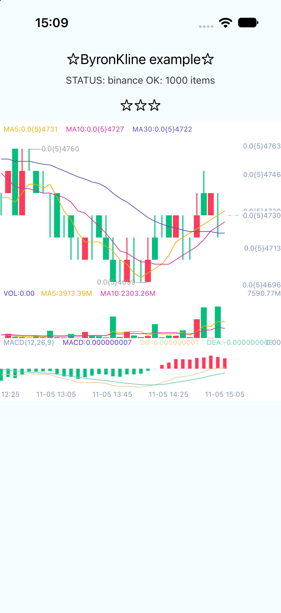

## react-native-kline

[](https://npmjs.org/package/react-native-kline "View this project on npm")
[](https://npmjs.org/package/react-native-kline "View this project on npm")
[](https://npmjs.org/package/react-native-kline "View this project on npm")
[](https://npmjs.org/package/react-native-kline "View this project on npm")


_仓库Android源码来源于[icechao/KlineChart](https://github.com/icechao/KlineChart). iOS源码来源于[h-js/KLine](https://github.com/h-js/KLine)_


<p align="center">
  
  
</p>

## Install

```shell
npm i --save react-native-kline
```

### 版本要求（Version requirements）

| react-native-kline | 架构 | react-native | 备注 |
| ------ | ------ | ------ | ------ |
| 3.x | **New Architecture / Fabric**（codegen spec，Android Kotlin + iOS Swift） | >= 0.76 | 不再支持旧架构（Paper），旧架构用户请使用 2.x |
| 2.x | 旧架构（JSBridge / Paper） | >= 0.60 | 维护分支 |

## Examples

To run examples:

```bash
npm i
npm start

#Android
npm run android

#iOS
cd ios/
pod install
npm run ios
```


## Props
> **iOS 说明**：上表标注 `Android iOS` 的属性两端均已支持。仍标注 `Android` 的属性（价格线价格框体系 `priceLabelInLine*`/`priceLabelRight*`、选中弹窗样式 `selected*`、X 轴标签体系、`betterXLabel`/`yLabelAlign`、`candleHollow`/`macdStrokeWidth` 空心蜡烛、`rsi2/3Color`、`wr2/3Color`、`volLineChartColor` 等）依赖 iOS 端 K 线引擎不具备的绘制能力，暂未实现。


| Prop | Type | Description | Platform |
| ------ | ------ | ------ | ------ |  
| datas | `` Array<KLineBar> `` |  K线历史数据 | Android iOS  |
| locales | `` Array<string> `` |  多语言配置 | Android iOS |
| indicators | `` Array<KLineIndicator> `` |  指标配置 | Android iOS |
| onMoreKLineData | `` (params: KLineCallbackParams) => void `` |  图表请求加载更多历史数据 | Android iOS |
| pricePrecision | number |  价格精度 | Android iOS |
| volumePrecision | number |  数量精度 | Android iOS  |
| mainBackgroundColor | string |  主图背景色 | Android iOS |
| selectedXLabelBackgroundColor | string |  设置选中X轴坐标背景色 | Android  |
| priceLabelInLineTextColor | string |  设置价格线上的文字颜色 | Android  |
| priceLabelInLineTextSize | number |  设置价格线上的文字大小 |  Android |
| selectedLabelTextColor | string |  设置选中X坐标文字颜色 |  Android |
| selectedLabelTextSize | number |  设置选中X坐标文字大小 | Android  |
| priceLabelInLineBoxMarginRight | number |  设置价格线上价格框离右距离 | Android  |
| priceLabelInLineShapeWidth | number | 价格线上价格图形宽  | Android  |
| priceLabelInLineShapeHeight | number | 价格线上价格图形高  | Android  |
| priceLabelInLineBoxHeight | number | 设置价格线上价格框高度  | Android  |
| priceLabelInLineBoxPadding | number | 设置价格线上价格框内边距  |  Android |
| priceLabelInLineBoxShapeTextMargin | number | 价格线上价格文字与图形的间隔  | Android  |
| priceLabelInLineClickable | boolean |  设置价格线价格框可点击 |  Android |
| priceLabelInLineBoxBackgroundColor | string |  设置右侧价格框背景色 | Android  |
| priceLabelRightBackgroundColor | string |  设置价格线右侧框背景 | Android  |
| priceLabelInLineBoxBorderColor | string |  设置价格线右侧框边框颜色 | Android |
| priceLabelInLineBoxBorderWidth | number |  设置价格线框边框宽度 | Android  |
| priceLabelInLineBoxRadius | number |  设置价格线上价格框圆角半径 | Android  |
| priceLineRightLabelBackGroundAlpha | number | 设置价格线右侧标签的背景透明度  | Android  |
| priceLabelRightTextColor | string | 设置价格线右侧价格文字的颜色  |  Android |
| priceLineRightColor | string |  设置价格线右侧的颜色 | Android  |
| priceLineWidth | number |  设置价格线的宽度  | Android iOS  |
| priceLineColor | string |  设置价格线颜色 | Android  |
| priceLineDotSolidWidth | number |  价格线虚线实心宽度 | Android iOS |
| priceLineDotStrokeWidth | number | 价格线实心间隔  | Android iOS |
| selectedXLineWidth | number |  设置选择器横线宽 | Android iOS  |
| selectedYLineWidth | number | 设置十字线竖线宽度  | Android iOS  |
| selectedXLineColor | string |  设置十字线横线颜色  | Android  |
| selectedYLineColor | string |  设置十字线竖线画笔颜色  | Android  |
| selectedYColor | string | 选中的线的Y轴颜色  | Android  |
| selectedCrossBigColor | string | 设置都十字线选中点外圆颜色 | Android  |
| selectedCrossPointRadius | number |  设置十字线相交小圆半径 | Android iOS  |
| selectedCrossPointColor | string |  设置十字线交点小圆颜色 |  Android |
| selectedShowCrossPoint | boolean | 设置选中时是否显示十字线的交点圆  | Android  |
| selectedPriceBoxBackgroundColor | string | 设置选中Y值背景色  | Android  |
| selectedInfoTextSize | number |  设置选择器文字大小 | Android  |
| selectedPriceBoxHorizontalPadding | number | 选中时价格label的横向padding  | Android  |
| selectedPriceBoxVerticalPadding | number | 选中时价格label的纵向padding  | Android  |
| selectedInfoBoxPadding | number |  选中信息框内边距,上下为此值*2 | Android  |
| selectedInfoBoxMargin | number | 选中行弹出框与边缘的距离  | Android  |
| selectedInfoBoxTextColor | string |  设置选择器弹出框文字颜色 | Android  |
| selectedInfoBoxBorderColor | string | 设置选择器弹出框边框颜色  |  Android |
| selectedInfoBoxBackgroundColor | string |设置选择器背景颜色  |  Android |
| selectedLabelBorderWidth | number |  选中时X坐标边框线宽| Android  |
| selectedLabelBorderColor | string | 选中时X坐标边框线颜色  | Android  |
| backgroundFillTopColor | string |  设置背景色顶部颜色  | Android iOS  |
| backgroundFillBottomColor | string |  设置背景色底部颜色  | Android iOS  |
| timeLineColor | string | 设置分时线颜色  | Android iOS  |
| timeLineFillTopColor | string | 设置分时线填充渐变的顶部颜色  | Android iOS |
| timeLineFillBottomColor | string | 设置分时线填充渐变的底部颜色  | Android iOS  |
| timeLineEndPointColor | string | 分时线呼吸灯的颜色  | Android iOS |
| timeLineEndRadius | number | 分时线呼吸灯的颜色半径  | Android iOS |
| selectedDateBoxVerticalPadding | number | 选中十字线X轴坐标连框纵向内边距  |  Android |
| selectedDateBoxHorizontalPadding | number | 选中十字线X轴坐标连框横向内边距  | Android  |
| mainLegendMarginTop | number | 设置主实图图例距离视图上边缘的距离  | Android iOS |
| legendMarginLeft | number | 设置图例距离视图左边缘的距离  | Android iOS |
| increaseColor | string |  设置涨的颜色 | Android iOS   |
| decreaseColor | string | 设置跌的颜色  | Android iOS   |
| betterXLabel | boolean | 设置是否自适应X左右边轴坐标的位置,默认true | Android  |
| labelTextSize | number | 设置坐标文字大小 | Android iOS  |
| labelTextColor | string | 设置坐标轴坐标文字颜色  | Android iOS  |
| yLabelAlign | boolean |  设置Y轴显示在左侧/右侧 |  Android |
| betterSelectedXLabel | boolean | b设置是否自适应X左右边轴坐标的位置,默认true|  Android |
| commonTextSize | number | 统一设置设置文字大小  | Android iOS |
| mainMarginTop | number | 设置上方padding  | Android iOS |
| paddingBottom | number | 设置下方padding  | Android iOS |
| childPaddingTop | number | 子视图的顶部padding  | Android iOS  |
| commonTextColor | string |  设置通用文字颜色 | Android iOS  |
| lineWidth | number | 全局通用线宽  | Android  |
| candleWidth | number | 设置每根蜡烛图宽度  | Android iOS |
| candleLineWidth | number |   设置蜡烛线画笔宽(空心时的线宽) | Android iOS  |
| limitTextColor | string | 设置主视图最大/最小值文字颜色 | Android iOS  |
| candleHollow | `` CandleHollow `` | 蜡烛是否空心  | Android  |
| gridLineWidth | number |  设置背景网格线宽 | Android iOS |
| gridLineColor | string |  设置背景网格线颜色 | Android iOS  |
| gridLineRows | number | 设置背景网格行数  | Android iOS  |
| gridLineColumns | number | 设置背景网格列数  | Android iOS |
| macdStrokeWidth | string | macd空心时线宽  |  Android |
| macdIncreaseColor | string | 设置macd 上涨颜色 | Android iOS  |
| macdDecreaseColor | string | 设置macd 下跌颜色 | Android iOS |
| macdWidth | number |  macd柱状图宽 | Android iOS  |
| difColor | string | 设置DIF颜色  | Android iOS  |
| deaColor | string | 设置DEA颜色  | Android iOS  |
| macdColor | string | 设置MACD颜色  | Android iOS  |
| wr1Color | string | 设置WR1颜色  | Android iOS |
| wr2Color | string | 设置WR2颜色    | Android  |
| wr3Color | string | 设置WR3颜色    | Android  |
| kColor | string |  设置K颜色 | Android iOS  |
| dColor | string |  设置D颜色 | Android iOS  |
| jColor | string | 设置J颜色  | Android iOS  |
| rsi1Color | string | 设置RSI1颜色  | Android iOS  |
| rsi2Color | string | 设置RSI2颜色 | Android  |
| ris3Color | string | 设置RSI3颜色   | Android  |
| ma1Color | string | 设置MA1颜色 |  Android iOS |
| ma2Color | string | 设置MA2颜色  |  Android iOS |
| ma3Color | string | 设置MA3颜色  |  Android iOS |
| volMa1Color | string | 设置交易量MA1颜色  | Android iOS  |
| volMa2Color | string | 设置交易量MA2颜色  | Android iOS  |
| volLegendColor | string |  交易量图例颜色 | Android iOS  |
| volLineChartColor | string |  设置当成交量视图显示为线时的颜色 | Android  |
| volLegendMarginTop | number | 交易量图例距离量视图上边缘的距离  | Android iOS  |
